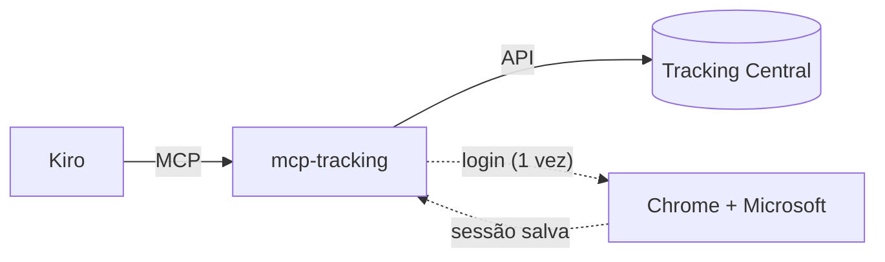
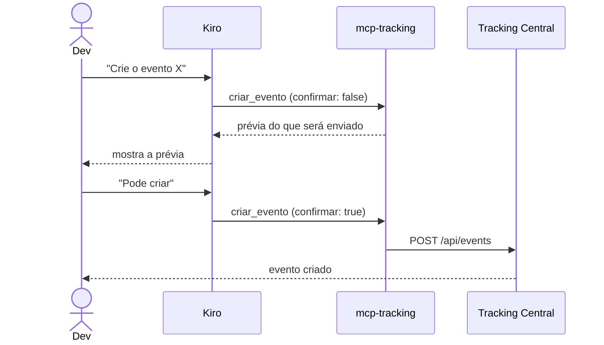

# 📡 mcp-tracking

Cole em `~/.kiro/settings/mcp.json` (global) ou `.kiro/settings/mcp.json` (só o projeto):

```json
{
  "mcpServers": {
    "tracking-central": {
      "command": "npx",
      "args": ["-y", "github:nicolaszalasik/mcp-tracking"],
      "disabled": false,
      "autoApprove": ["listar_destinos", "buscar_eventos", "ver_evento"]
    }
  }
}
```


**Crie e edite eventos na Tracking Central da OLX conversando com o Kiro, sem abrir a tela.**
Peça o evento, confira a prévia e aprove. O nome, o schema e as tags saem no padrão da Autos 360.

---

## ✨ O que ele faz

| | Tool | Para que serve |
| :-: | --- | --- |
| 🔐 | `login` | Abre o Chrome para você entrar com a conta Microsoft da OLX e guarda a sessão |
| 🔎 | `buscar_eventos` | Acha eventos pelo nome e devolve o id. Use antes de criar, para não duplicar |
| 👁️ | `ver_evento` | Mostra o evento e o schema atual pelo id |
| 🎯 | `listar_destinos` | Lista os destinos (Datalake OLX, GA...). Não exige login |
| 🆕 | `criar_evento` | Cria um ou vários eventos de uma vez |
| ➕ | `adicionar_campo_evento` | Adiciona campos opcionais a um evento que já existe |

> [!IMPORTANT]
> `criar_evento` e `adicionar_campo_evento` **só mostram a prévia** por padrão. Eles gravam na central apenas depois que você aprova e o Kiro envia `confirmar: true`.

## 🚀 Instalação

Você precisa de **Node 18+**, do **Google Chrome** (usado no `login`) e de acesso ao repositório, com credencial do GitHub no git.

1. Cole o JSON do topo no `mcp.json` do Kiro. Ao salvar, o Kiro recarrega os servidores sozinho.
2. Peça: **"rode a tool login"**. Uma janela do Chrome abre, você entra com a conta da OLX e pronto. A sessão fica salva no seu computador.

O `autoApprove` libera só as tools de **leitura**. Deixe `login`, `criar_evento` e `adicionar_campo_evento` de fora, para o Kiro pedir a sua aprovação.

Se o Kiro não achar o `npx` (comum quando o Node vem do nvm), troque `"command": "npx"` pelo caminho absoluto que `which npx` mostrar no terminal.

## 💬 Exemplos de pedidos

```text
Busque os eventos que têm "botao_fechar" no nome.

Crie o evento click no objeto confirmar_retransmitir, detalhe confirmar_retransmitir,
descrição "Ao clicar em Confirmar e retransmitir", com o campo extra tipoRejeicao.

Adicione o campo tipoRejeicao ao evento 11536.
```

O Kiro monta a prévia, você confere e aprova. Se faltar algo, como as **tags** ou o **time** dono, ele pergunta antes de criar.

## 🧩 Como funciona





## 🏷️ Padrão dos eventos

O nome segue `{eventType}-a360_{objectName}-{objectDetail}`. O prefixo `a360_` é adicionado sozinho quando falta.

```text
click-a360_botao_fechar_nfe-botao_fechar_nfe
```

Todo evento nasce com os campos `userGuid`, `organizationGuid` e `temaExperiencia`. **Nenhum campo é obrigatório**, porque um valor nulo faria a central recusar o evento. Campos extras entram como opcionais.

> [!WARNING]
> Os campos não podem ter dado pessoal do usuário (LGPD). Use identificadores e categorias, nunca nome, e-mail ou CPF.

## ⚙️ Configuração (opcional)

Os padrões já servem ao time Altimus. Para mudar, ponha as variáveis dentro de `"env"` no `mcp.json`:

```json
"env": { "TC_TAGS": "altimus,web", "TC_OWNER_TEAM_ID": "77" }
```

| Variável | Padrão | Para que serve |
| --- | --- | --- |
| `TC_OWNER_TEAM_ID` | `77` | Time dono dos eventos criados |
| `TC_TAGS` | `altimus,web` | Tags dos eventos criados |
| `TC_DESTINATION` | `datalake-olx` | Destino, resolvido pelo nome |
| `TC_DESTINATION_ID` | automático | Id do destino, se a busca pelo nome falhar |
| `TC_OBJECT_PREFIX` | `a360_` | Prefixo do `objectName` |
| `TC_BASE_URL` | central `-beta` | Endereço da Tracking Central |
| `TC_COOKIE` | vazio | Cookie manual. Só use se não houver Chrome |

## 🔒 Segurança

- A sessão fica em `~/.config/mcp-tracking-central/session.json`, com permissão `600`. Fica fora do repositório e só é enviada à própria Tracking Central.
- Se a sessão expirar, o MCP avisa: rode `login` de novo.
- Nunca cole cookies em chats, issues ou commits.
- Cada pessoa usa a própria sessão, então toda criação ou edição fica no nome de quem fez.

## 🛠️ Problemas comuns

| Sintoma | O que fazer |
| --- | --- |
| "Sessão ... ausente ou expirada" | Peça para rodar a tool `login` |
| `npx` não encontrado | Use o caminho absoluto de `which npx` em `command` |
| Falha ao baixar o projeto | Confira o acesso ao repositório e a credencial do GitHub no git |
| Não abre o Chrome no `login` | Instale o Google Chrome |
| Quero a versão mais nova | Rode `npx clear-npx-cache` e reinicie o Kiro |

## 👩‍💻 Desenvolvimento

```bash
git clone https://github.com/nicolaszalasik/mcp-tracking.git
cd mcp-tracking
npm install
npm test
```

Para testar a sua cópia local, troque no `mcp.json` o `command` e o `args`:

```json
"command": "node",
"args": ["/caminho/para/mcp-tracking/src/server.js"]
```

Os testes cobrem a montagem dos payloads e **não** chamam a central.

```text
src/
├── server.js     # tools do MCP
├── client.js     # chamadas HTTP à Tracking Central
├── eventos.js    # nome, schema e payloads dos eventos
├── login.js      # login pelo Chrome (Microsoft)
├── session.js    # sessão salva no disco
└── config.js     # variáveis de ambiente e padrões
```
